# Indulás 3 lépésben, 5 perc

**A teljes tananyag egy helyen:** [https://is.gd/oriana1112anyag](https://is.gd/oriana1112anyag) (böngészhető oldal; a workshop előtti feltöltés után érhető el).

Egy üres mappát hozol létre, egy lokális ChatGPT-projektet állítasz rá, és a projektben egy üzenettel az AI kialakítja a munkaterületet. Érkezéskor, 09:00 előtt végezd el; a nap 2026-11-12-én 09:00-kor indul.

A képek a ChatGPT asztali alkalmazás magyar felületéről készültek (2026. november). A Windows saját ablakai (Fájlkezelő, mappaválasztó) a Windows nyelvén jelennek meg.

## 1. Hozz létre egy üres mappát

Hozd létre ezt a mappát közvetlenül a felhasználói profilod alatt: `C:\Users\<felhasználónév>\Wenova-AI-workshop` (a `<felhasználónév>` a saját Windows-bejelentkezésed). Ne a Dokumentumok vagy az Asztal alá tedd: azokat a OneDrive szinkronizálja, és a Work ott nem működik megbízhatóan.

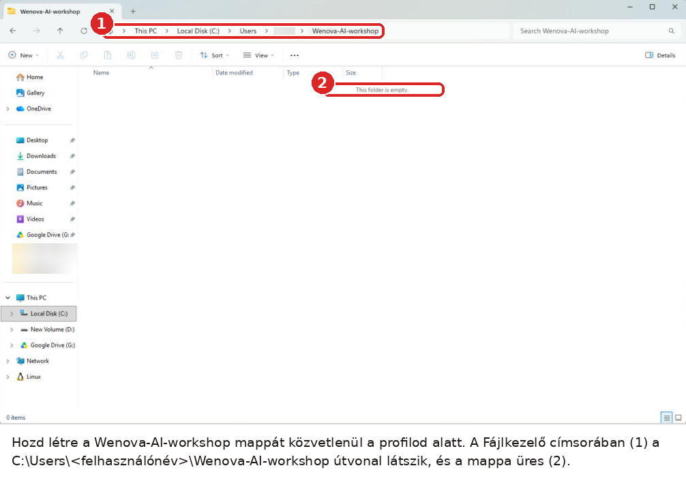

**Így ellenőrzöd:** A Fájlkezelő címsorában `C:\Users\<felhasználónév>\Wenova-AI-workshop` áll, és a mappa üres.

## 2. Hozz létre egy lokális projektet, és add hozzá a mappát

Nyisd meg a ChatGPT asztali alkalmazást, és jelentkezz be.

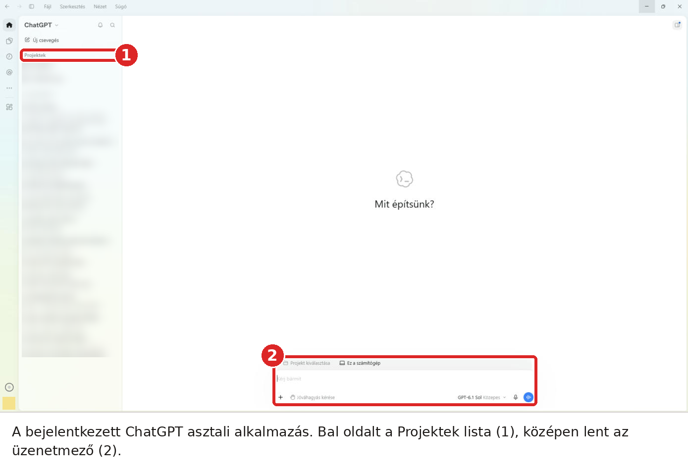

Vidd az egeret a bal oldali **Projektek** felirat fölé, és kattints a sor végén megjelenő **+** jelre. A **Projekt létrehozása** ablakban a **Projektnév** mezőbe írd be: `Oriana AI-workshop`.

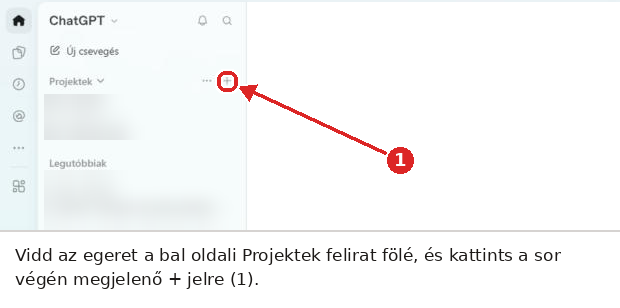

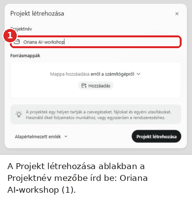

Ugyanebben az ablakban, a **Forrásmappák** alatt kattints a **Hozzáadás** gombra, a mappaválasztóban lépj a profilmappádba, jelöld ki a `Wenova-AI-workshop` mappát, és kattints a **Select Folder** gombra (magyar Windowson a gomb felirata magyar). Ezután kattints a **Projekt létrehozása** gombra.

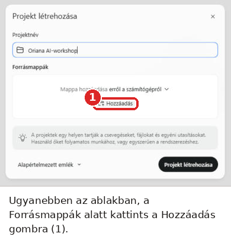

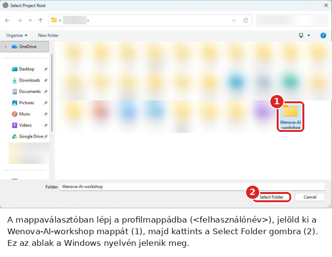

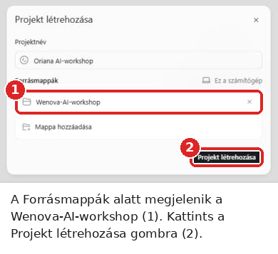

A ChatGPT megkérdezi: **Megbízol ebben a mappában?** Kattints a **Mappa megbízhatónak jelölése** gombra, különben a Work nem tud a mappában olvasni és írni.

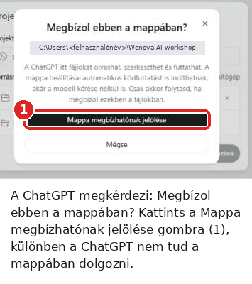

Modellnek válaszd a GPT-6 Lunát. A modellt nem a projekt beállításaiban, hanem az üzenetmező jobb alsó sarkában választod: kattints a modell nevére, a felugró ablakban még egyszer a modell nevére, majd a listában a **GPT-6 Luna** sorra. A választás az új beszélgetésekre is megmarad.

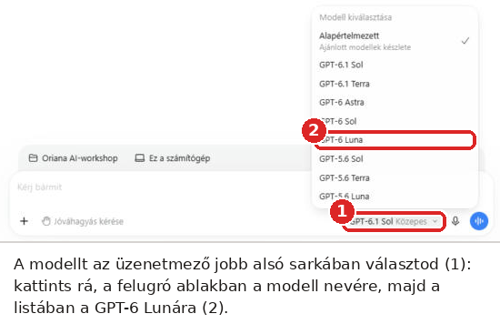

Projektutasítást ebben a ChatGPT-változatban nem kell (és nem is lehet) megadni: a helyi projekt **Projekt szerkesztése** ablakában (a projekt neve melletti ··· menüben) csak a név és a forrásmappák állíthatók. Az AI minden új beszélgetésben a mappa gyökerébe másolt `AGENTS.md` szabályai szerint dolgozik. A három soros projektutasítás a `Tananyag/AI-asszisztens/Projekt_utasitas.md` fájlban tartalékként megvan, ha egy későbbi változatban megjelenik a mező.

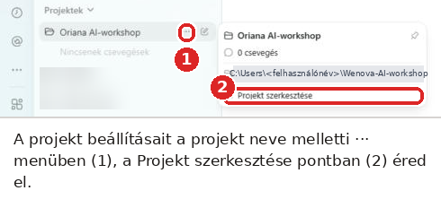

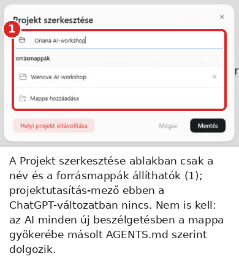

**Így ellenőrzöd:** A projekt megnyitva, középen „Min dolgozzunk a(z) Oriana AI-workshop projektben?” áll, a mappája a `Wenova-AI-workshop`, és a modell a GPT-6 Luna.

## 3. Indíts új beszélgetést a projektben, és küldd el ezt az egy üzenetet

A projekt létrehozása után rögtön a projekt új beszélgetésében vagy; később a projekt sorának jobb szélén, a ceruza ikonnal nyitsz újat. A helyi projekt beszélgetései Work (ügynök) módban futnak, külön módválasztó nincs. Az üzenetmező fölött a projekt neve látszik. Illeszd be és küldd el:

```text
Töltsd le a workshop tananyagát innen: https://is.gd/oriana1112 (egy ZIP). Bontsd ki a Wenova-AI-workshop mappa Tananyag almappájába úgy, hogy a külső mappát kihagyod, majd kövesd a Tananyag/SETUP.md lépéseit.
```

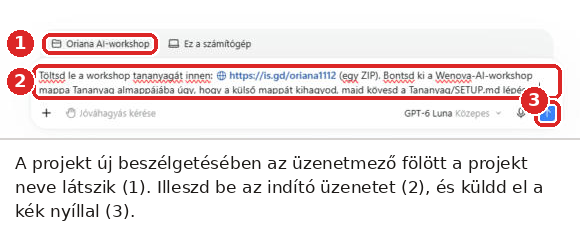

A rövid link (https://is.gd/oriana1112) a tananyag ZIP-jére mutat, átirányítással. Ha a ChatGPT nem követi az átirányítást, használd a hosszú linket: `https://github.com/cspiya/oriana-ai-workshop-2026-11/archive/refs/heads/main.zip`; tartalékként a repó oldalán (https://github.com/cspiya/oriana-ai-workshop-2026-11) a Code → Download ZIP. Az AI a ZIP-et a Wenova-AI-workshop mappába tölti le, a külső `oriana-ai-workshop-2026-11-main` mappát kihagyja, a belső almappákat megőrzi.

Munka közben a ChatGPT engedélyt kér (**Engedélyezed…?**): a végigfutáskor a letöltéshez és egy záró ellenőrző parancshoz kért. Nézd meg, hogy a `Wenova-AI-workshop` mappában dolgozik, és kattints az **Egyszeri engedélyezés** gombra. A **Kibontás** linkkel a teljes parancsot is megnézheted.

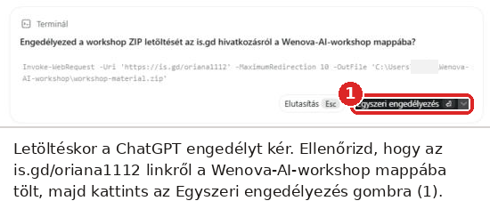

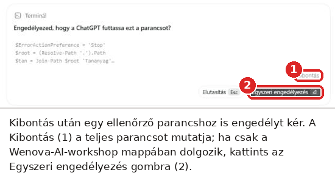

Ha az AI kérdez, például hogy frissítse-e a meglévő Tananyagot, a saját szavaiddal válaszolj.

**Így ellenőrzöd:** Az AI elkezdi kialakítani a munkaterületet, majd felsorolja az elkészült mappákat és a következő lépést.

## Mi történik ezután

- Az AI a tananyagot a rövid linkről (ZIP) tölti le, majd a tartalmát a `Tananyag` almappába bontja ki, fölösleges külső mappaszint nélkül. A letöltött ZIP (`workshop-material.zip`) a mappa gyökerében maradhat.
- Létrehozza a `Munka` mappát és a kilenc gyakorlat-almappát (`00-Alapozas`, `01-DNS`, `02-Portal`, `03-Kozos`, `04-Agent`, `05-Reviewer`, `06-Sites`, `06b-BA-utotag`, `07-Sajat`).
- Bemásolja az `AGENTS.md` fájlt a `Wenova-AI-workshop` mappa gyökerébe.
- Ellenőrzi, és kattintható linkekkel felsorolja, mi készült el (a végigfutáskor kb. 3 perc alatt).
- Kattintható linket ír a `Tananyag\index.html` napi térképhez; erre kattintva a ChatGPT beépített böngészőpaneljében nyílik meg.
- Megmondja, hogy az első gyakorlatot egy új beszélgetésben indítsd, és melyik üzenettel.

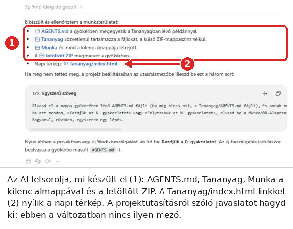

Ha a visszajelzés a projekt utasításmezőjébe illesztendő három sort is javasol, hagyd ki: ebben a ChatGPT-változatban nincs ilyen mező, és nem is kell.

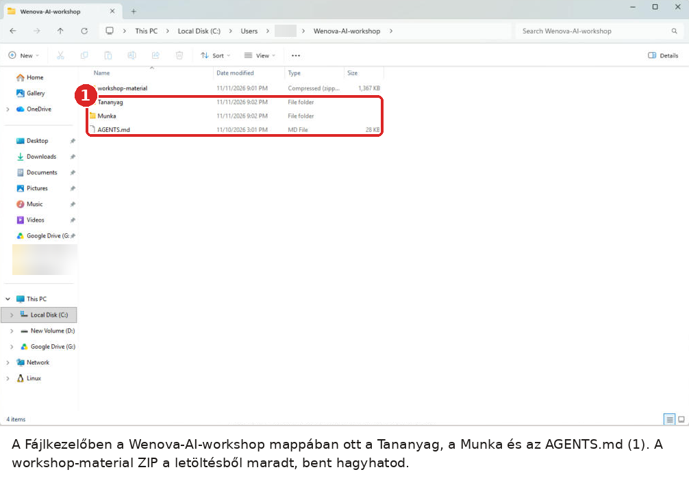

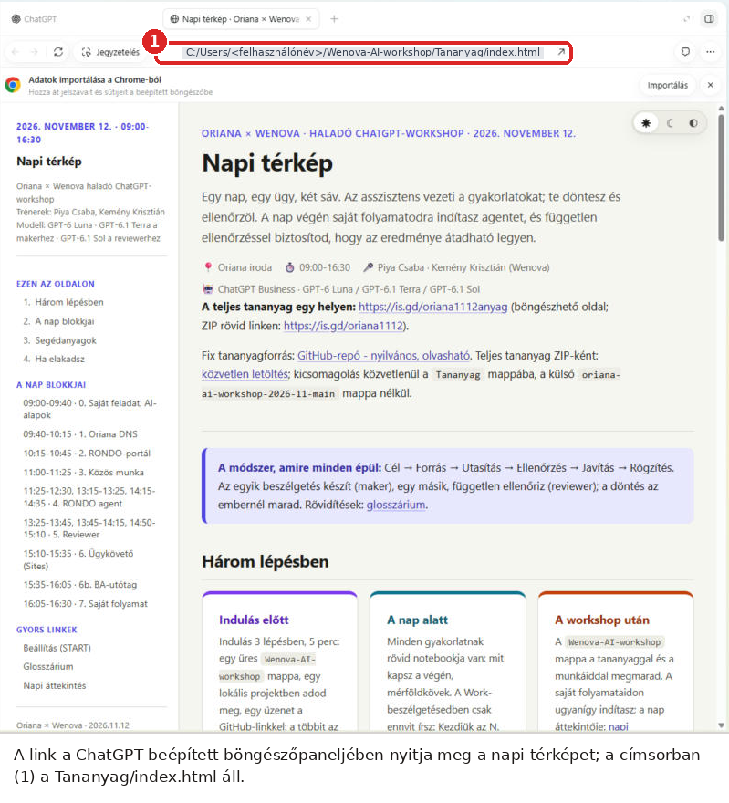

**Így ellenőrzöd:** A `Wenova-AI-workshop` mappában ott van a `Tananyag` és a `Munka`, valamint az `AGENTS.md`, a `Tananyag\index.html` pedig megnyílik.

## Az első gyakorlat

Ugyanebben a projektben nyiss egy **új** beszélgetést (a projekt sorának jobb szélén, a ceruza ikonnal), és abban írd be: „Kezdjük a 0. gyakorlatot.” Az új beszélgetés az elején automatikusan beolvassa a mappa gyökerébe került `AGENTS.md` szabályait; a beállító beszélgetés indulásakor ez a fájl még nem létezett. Az AI a gyakorlat céljával kezd, majd egy kérdést tesz fel. A nap többi gyakorlatát is itt indítod: „Kezdjük az N. gyakorlatot” (N = 0…7, illetve „Kezdjük a 6b gyakorlatot”), több fázisú gyakorlatnál „Folytassuk az N. gyakorlatot”.

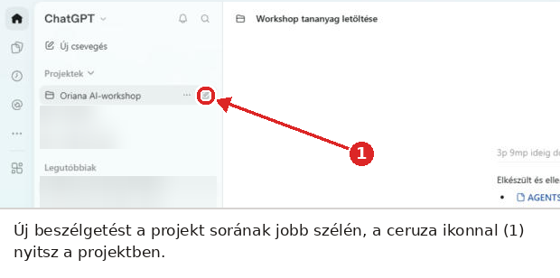

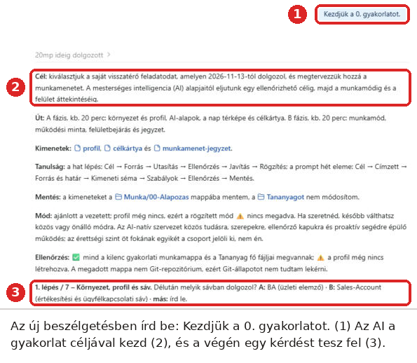

**Így ellenőrzöd:** Az AI a 0. gyakorlat céljával kezd, majd egy kérdést tesz fel.

## Ha nem megy

- A Work nem ír a mappába: a mappa hozzáadásakor a „Megbízol ebben a mappában?” kérdésre a Mappa megbízhatónak jelölése gombbal kell felelni; ha kimaradt, vedd ki és add hozzá újra a mappát (a projekt ··· menüjében, Projekt szerkesztése).
- A projektben nem tudod hozzáadni a mappát, vagy a Work nem látja: a ChatGPT asztali alkalmazást használd, ne a webes felületet; ellenőrizd, hogy a projekt lokális (helyi mappás), nem megosztott.
- Elutasítottál egy engedélykérést: írd be, hogy „Folytasd, most engedélyezem”, és a következő kérésnél kattints az Egyszeri engedélyezés gombra.
- A rövid link nem működik (a ChatGPT nem követi az átirányítást): írd az üzenetbe a hosszú ZIP-linket (`https://github.com/cspiya/oriana-ai-workshop-2026-11/archive/refs/heads/main.zip`), vagy a repó oldalán (https://github.com/cspiya/oriana-ai-workshop-2026-11) a Code → Download ZIP útját.
- Nincs hálózat, vagy a GitHub nem elérhető: a trénertől kapott ZIP-et tedd a mappába, majd írd be: „A ZIP a mappában van, ebből alakítsd ki a munkaterületet.”
- Az AI elakad egy parancsnál: kérd meg, hogy mondja meg, melyik lépésnél akadt el, és szólj a trénernek.
- Új beszélgetést nyitottál, és az AI nem követi a szabályokat: írd be: „Olvasd el az AGENTS.md fájlt, és aszerint dolgozz.”

## Trénereknek: mit ellenőrizz körbejárva

- Van `Oriana AI-workshop` projekt, benne a `Wenova-AI-workshop` mappa megbízhatóként engedélyezve, és a modell a GPT-6 Luna.
- Megvan a `Tananyag` és a `Munka` mappa (kilenc almappával), valamint a gyökérben az `AGENTS.md`; a `Tananyag\index.html` megnyílik.
- Az első válasz a 0. gyakorlat céljával kezdődik, és kérdést tesz fel.
